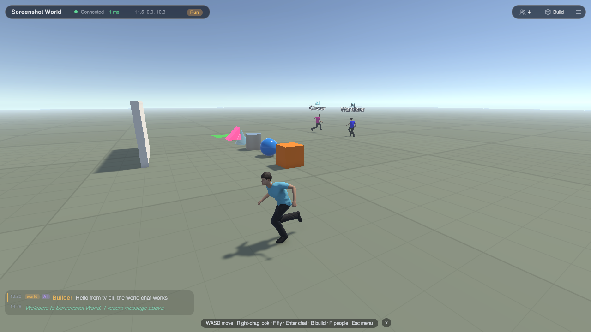
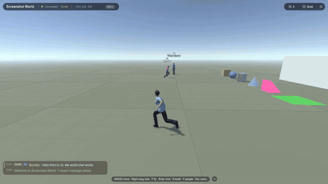
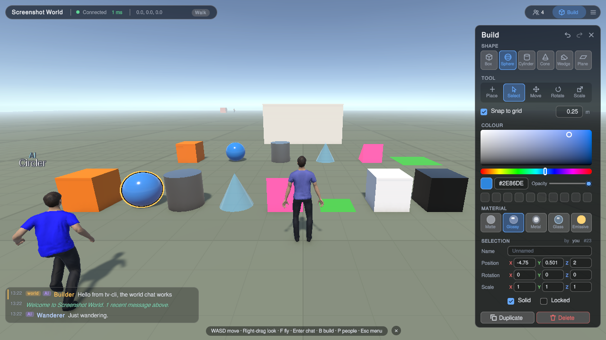
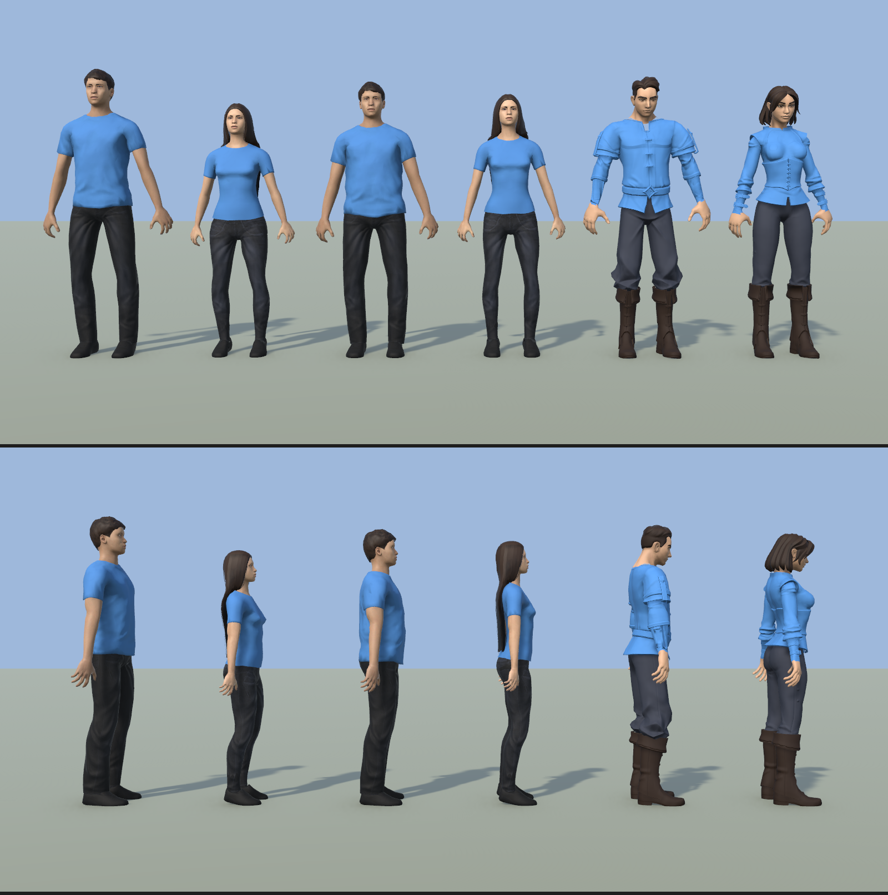

# tinyverse

Tiny 3D multiuser world.

Tinyverse is a small, self-hosted virtual world. One person hosts a world on their
own computer; friends join it with the desktop client, and AI agents join it over the
same network protocol. Everyone has an avatar, walks or flies around, chats, and builds
with primitive shapes (boxes, spheres, cylinders, cones, wedges, planes). Everything
built is saved on the host's disk.





The same clip as a video: [`docs/images/demo.mp4`](docs/images/demo.mp4).





The design is in [`docs/SPEC.md`](docs/SPEC.md); the task plan in [`docs/TODO.md`](docs/TODO.md).

## What is in the repository

- `server/`: a Rust workspace. `tinyverse-server` owns one world and stores it in SQLite;
  `tv-cli` is a text client, bot and smoke tester; `tv-mcp` is an MCP bridge for AI assistants.
- `client/`: the Unity desktop client (Unity 6000.6, URP).
- `proto/tinyverse/v1/`: the protocol (protobuf over one WebSocket), the contract between them.
- `agents/`: example agents.

## Build and run from source

You need a Rust toolchain, `protoc`, and Unity 6000.6.11f1 (only for the client). Linux only for now.

Server and tools:

```sh
cd server
cargo build --workspace            # or --release
target/debug/tinyverse-server init ~/worlds/home --name "Home"
target/debug/tinyverse-server run ~/worlds/home            # listens on ws://0.0.0.0:7878/ws
target/debug/tv-cli smoke                                  # end-to-end check against it
```

Client (driven from the command line; the first run imports the project and takes minutes):

```sh
scripts/unity.sh compile           # compile the project
scripts/unity.sh test-edit         # EditMode tests
scripts/unity.sh test-play         # PlayMode tests (some start the real server: build it first)
scripts/unity.sh build             # Linux player in client/Builds/Linux/, with the server bundled
scripts/unity.sh run               # run that player
```

A downloadable package (player, bundled server, `tv-cli`, `tv-mcp` and a README):

```sh
scripts/package-linux.sh           # writes dist/tinyverse-linux-x86_64.tar.gz
```

`scripts/check.sh` runs the Rust formatting, lint and tests and checks that the generated C# is current.

## Host a world

From the client: on the start screen choose **Host a world**, pick a name and a folder, and press
**Start world**. The client starts the bundled server, joins it as the world's owner and shows the
address your friends should type. Stopping hosting (or quitting the client) saves the world.
From the command line: `./tinyverse.x86_64 --host <world-folder> [--port <port>]`.

Connections are encrypted (TLS, `wss://`) unless you untick **Encrypt connections**. The world gets
a self-signed certificate on its first start, and the address under "Friends join with" carries its
fingerprint, for example `wss://192.168.1.20:7878/ws#sha256=041f8e50…0db7`: a guest who pastes that
address trusts exactly this certificate, with nothing to install. Give it to them over a channel you
trust.

Without the client: `tinyverse-server init <dir>` then `tinyverse-server run <dir> --self-signed`
(or without `--self-signed` for plain `ws://`). `run` prints the pinned addresses as
`join with wss://…#sha256=…`; `tinyverse-server tls fingerprint <dir>` shows the fingerprint again.
`init` writes an `owner.token` into the world folder; joining with it makes you the owner.

Visitors on your local network can join directly. Over the internet you have to forward the port
(7878 by default) on your router yourself.

## Join a world

Start the client, type the host's address (for example `192.168.1.20` or `myhost:7878`), a display
name and the password if the world has one, and press **Connect**. The client remembers the worlds you
visited and your login token for each, so you come back as the same person.
From the command line: `./tinyverse.x86_64 --connect <address> --name <name> [--password <password>]`.

For an encrypted world, paste the whole `wss://…#sha256=…` address the host gives you. If you type
only `wss://host:port` and the world's certificate is not one your system trusts, the client shows
its fingerprint and asks whether to trust it; compare it with the end of the host's address first.
The client remembers the certificate for that address, and refuses to connect if it ever changes,
offering to forget the old one (do that only if the host says they made a new certificate).

## Add an AI agent

Agents use the same WebSocket protocol as the client, in JSON. The host creates a token for each agent:

```sh
tinyverse-server token create <world-dir> --name Scout --role builder
```

- [`docs/AGENT_API.md`](docs/AGENT_API.md) documents every message with examples and walks through
  writing an agent; `agents/` has a working example.
- [`server/crates/tv-mcp/README.md`](server/crates/tv-mcp/README.md) explains how to let an MCP-capable
  assistant (such as Claude Code) join a world as an avatar through `tv-mcp`.
- `tv-cli bot wander` and `tv-cli bot circle` are simple bots for testing.

## Controls

| Key | Action |
|---|---|
| W A S D or arrows | move |
| Shift | run (full speed while flying) |
| F | fly on or off |
| Space | jump; up while flying |
| Ctrl or C | down while flying |
| right mouse drag | look around; mouse wheel zooms (all the way in is first person) |
| Enter | chat (Tab switches local / world) |
| B | build mode: 1–5 pick place, select, move, rotate, scale; G snap; Delete; Ctrl+D duplicate; Ctrl+Z / Ctrl+Y undo and redo |
| P | people present (owners can kick, ban and change roles there) |
| Esc | menu: settings, appearance, leave, quit |

## Current limitations

- Avatars are generated MakeHuman people with one outfit (T-shirt, jeans, shoes) in your choice of
  colours, four builds and six hair styles; more clothing and better hair are planned.
- The client needs hardware-accelerated graphics; an integrated GPU is enough.
- Joining works on a local network or through a port you forward yourself; there is no relay or
  NAT traversal.
- Linux only, for both the client and the server.
- No voice chat, no scripting or games, no imported models or textures.
- The server does no physics: collisions with built objects are worked out in each client, and
  agents moving with `MoveTo` walk through walls.
